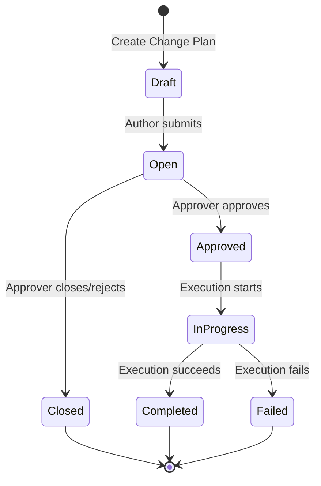

# Approval Workflow Engine Architecture

## Overview

The Approval Workflow Engine manages the approval process for Change Plans in Deeb. It implements a single-approval flow where one approver can approve or close (reject) a Change Plan. The workflow ensures that Change Plans with SQL Review errors cannot be approved and maintains a complete audit trail of all approval actions.

## Single-Approval Flow

### Flow Description

The single-approval workflow is a straightforward process designed for MVP simplicity:

1. **Draft State**: Author creates a Change Plan in `Draft` status
2. **Open State**: Author submits the Change Plan, moving it to `Open` status
3. **Review State**: An approver (Project Approver) reviews the Change Plan:
   - Reviews SQL content and policy findings
   - Checks for SQL Review errors (must be zero)
   - Can approve or close (reject) the Change Plan
4. **Approved State**: Upon approval, Change Plan moves to `Approved` status (ready for execution)
5. **Closed State**: If rejected, Change Plan moves to `Closed` status

### Flow Diagram



## Approval State Machine

### State Transitions

| From State | To State | Action | Validator | Notes |
|------------|----------|--------|-----------|-------|
| Draft | Open | Submit | Author only | Author submits for review |
| Open | Approved | Approve | Project Approver | Requires no SQL Review errors |
| Open | Closed | Close | Project Approver | Rejection (can include comments) |
| Approved | InProgress | Execute | Execution engine | Moved by execution engine |
| InProgress | Completed | Success | Execution engine | Execution completed successfully |
| InProgress | Failed | Error | Execution engine | Execution failed |

### State Definitions

- **Draft**: Change Plan is being created/edited by the author
- **Open**: Change Plan is submitted and waiting for approval
- **Approved**: Change Plan has been approved and is ready for execution
- **Closed**: Change Plan has been rejected/closed by an approver
- **InProgress**: Change Plan is currently being executed
- **Completed**: Change Plan execution completed successfully
- **Failed**: Change Plan execution failed
- **Cancelled**: Change Plan was cancelled before execution

## Approval Requirements

### SQL Review Error Check

**Critical Requirement**: A Change Plan **cannot be approved** if it has any SQL Review errors (severity = `Error`).

#### Error Check Logic

1. Query `policy_findings` table for the Change Plan ID
2. Filter findings where `severity = 'Error'`
3. If any error findings exist:
   - Approval is **blocked**
   - Return error: "Cannot approve Change Plan with SQL Review errors"
   - List all error findings in the error message
4. If no error findings:
   - Approval is **allowed**
   - Warnings and Info findings are allowed (they don't block approval)

#### Implementation

```go
// Pseudo-code for error check
func (s *ApprovalService) canApprove(changePlanID uuid.UUID) (bool, []PolicyFinding, error) {
    // Get all policy findings for the change plan
    findings, err := s.policyFindingRepo.GetByChangePlanID(ctx, changePlanID)
    if err != nil {
        return false, nil, err
    }
    
    // Filter for errors only
    errors := filterBySeverity(findings, "Error")
    
    if len(errors) > 0 {
        return false, errors, ErrCannotApproveWithErrors
    }
    
    return true, nil, nil
}
```

### Approval Permissions

Only users with the following roles can approve Change Plans:

- **Project Approver**: Project-level role assigned via `project_members` table
- **Organization Admin**: Organization-level admin role
- **Organization DBA**: Organization-level DBA role
- **Project Owner**: Project-level owner role

### Optional Reviewer Assignment

Change Plans can optionally have an `assigned_reviewer_id` field:

- **Purpose**: Assign a specific reviewer to a Change Plan
- **Behavior**: 
  - If set, serves as a suggestion/hint for who should review
  - Does **not** restrict approval to only that reviewer
  - Any Project Approver can still approve/reject
- **Use Case**: Helps distribute review workload or assign domain experts

## Approval Workflow Service Architecture

### Service Interface

```go
type ApprovalService interface {
    // Approve approves a Change Plan
    // Requires: no SQL Review errors, valid approver permissions
    Approve(ctx context.Context, changePlanID uuid.UUID, approverID uuid.UUID, comments *string) error
    
    // Close rejects/closes a Change Plan
    // Requires: valid approver permissions
    Close(ctx context.Context, changePlanID uuid.UUID, approverID uuid.UUID, comments *string) error
    
    // GetApprovalHistory retrieves approval history for a Change Plan
    GetApprovalHistory(ctx context.Context, changePlanID uuid.UUID) ([]*models.Approval, error)
}
```

### Service Dependencies

The Approval Service depends on:

1. **ApprovalRepository**: Stores approval records
2. **ChangePlanRepository**: Updates Change Plan status
3. **PolicyFindingRepository**: Checks for SQL Review errors
4. **ProjectMemberRepository**: Validates approver permissions
5. **RBAC Service**: Validates organization-level roles

### Service Methods

#### Approve Method

**Purpose**: Approve a Change Plan, moving it from `Open` to `Approved` status.

**Validation Steps**:
1. Verify Change Plan exists and is in `Open` status
2. Verify approver has permission (Project Approver role or Org Admin/DBA)
3. Check for SQL Review errors (must be zero)
4. Create approval record with status `Approved`
5. Update Change Plan status to `Approved`
6. Create audit log entry

**Error Cases**:
- Change Plan not found → `ErrNotFound`
- Change Plan not in `Open` status → `ErrInvalidStatus`
- Approver lacks permission → `ErrUnauthorized`
- SQL Review errors exist → `ErrCannotApproveWithErrors`

#### Close Method

**Purpose**: Reject/close a Change Plan, moving it from `Open` to `Closed` status.

**Validation Steps**:
1. Verify Change Plan exists and is in `Open` status
2. Verify approver has permission (Project Approver role or Org Admin/DBA)
3. Create approval record with status `Rejected`
4. Update Change Plan status to `Closed`
5. Create audit log entry

**Error Cases**:
- Change Plan not found → `ErrNotFound`
- Change Plan not in `Open` status → `ErrInvalidStatus`
- Approver lacks permission → `ErrUnauthorized`

## Approval Comments and History

### Comments Support

Both `Approve` and `Close` methods accept optional comments:

- **Purpose**: Allow approvers to provide feedback or reasoning
- **Storage**: Stored in `approvals.comments` field (TEXT, nullable)
- **Display**: Comments are included in approval history responses
- **Use Cases**:
  - Approve: "Looks good, approved for deployment"
  - Close: "SQL syntax error on line 15, please fix"

### Approval History

The approval history is maintained in the `approvals` table:

- **Ordering**: Returned ordered by `created_at DESC` (most recent first)
- **Records**: Each approval/rejection creates a new record
- **Fields**: 
  - `id`: Unique approval record ID
  - `change_plan_id`: Change Plan being approved
  - `approver_id`: User who approved/rejected
  - `status`: `Approved` or `Rejected`
  - `comments`: Optional comments from approver
  - `approved_at`: Timestamp (set for Approved, null for Rejected)
  - `created_at`: Record creation timestamp

### History Retrieval

```go
// GetApprovalHistory retrieves all approval records for a Change Plan
func (s *ApprovalService) GetApprovalHistory(ctx context.Context, changePlanID uuid.UUID) ([]*models.Approval, error) {
    return s.approvalRepo.GetHistory(ctx, changePlanID)
}
```

## Database Schema

### approvals Table

```sql
CREATE TABLE approvals (
    id UUID PRIMARY KEY DEFAULT gen_random_uuid(),
    change_plan_id UUID NOT NULL,
    approver_id UUID NOT NULL,
    status VARCHAR(50) NOT NULL, -- 'Approved' or 'Rejected'
    comments TEXT,
    approved_at TIMESTAMP WITH TIME ZONE,
    created_at TIMESTAMP WITH TIME ZONE NOT NULL DEFAULT CURRENT_TIMESTAMP,
    
    CONSTRAINT check_approval_status CHECK (status IN ('Approved', 'Rejected')),
    CONSTRAINT unique_approval_per_user_change_plan UNIQUE (change_plan_id, approver_id),
    CONSTRAINT fk_approvals_change_plan FOREIGN KEY (change_plan_id) REFERENCES change_plans(id) ON DELETE CASCADE,
    CONSTRAINT fk_approvals_approver FOREIGN KEY (approver_id) REFERENCES users(id) ON DELETE RESTRICT
);
```

### change_plans Table (Status Field)

The `change_plans.status` field stores the current state:
- `Draft`: Initial state
- `Open`: Submitted, awaiting approval
- `Approved`: Approved, ready for execution
- `Closed`: Rejected/closed
- `InProgress`: Currently executing
- `Completed`: Execution succeeded
- `Failed`: Execution failed
- `Cancelled`: Cancelled before execution

## Error Handling

### Error Types

1. **ErrNotFound**: Change Plan not found
2. **ErrInvalidStatus**: Change Plan not in correct status for operation
3. **ErrUnauthorized**: Approver lacks required permissions
4. **ErrCannotApproveWithErrors**: Change Plan has SQL Review errors
5. **ErrAlreadyApproved**: Change Plan already approved (if attempting duplicate approval)

### Error Responses

All errors should:
- Be wrapped with context using `fmt.Errorf("...: %w", err)`
- Include relevant Change Plan ID in error message
- Include approver ID in error message (for audit)
- Be logged for audit purposes

## Audit Logging

All approval actions must create audit log entries:

- **Action**: `change_plan.approved` or `change_plan.closed`
- **Resource Type**: `change_plan`
- **Resource ID**: Change Plan ID
- **User ID**: Approver ID
- **Details**: JSONB containing:
  - `status`: Approval status (Approved/Rejected)
  - `comments`: Approval comments (if any)
  - `previous_status`: Previous Change Plan status
  - `new_status`: New Change Plan status

## Future Enhancements

The current architecture supports future enhancements:

1. **Multi-approval flows**: Can extend to require multiple approvers
2. **Conditional approval**: Can add logic for different approval requirements based on risk level
3. **Approval delegation**: Can add support for delegating approvals
4. **Approval notifications**: Can integrate notification system for approval requests
5. **Approval timeouts**: Can add automatic rejection after timeout period

## Implementation Notes

- Approval service should be created in `backend/internal/services/approval_service.go`
- Service should use dependency injection for repositories
- All database operations should be wrapped in transactions for consistency
- Service methods should validate input parameters
- Error messages should be user-friendly and actionable

