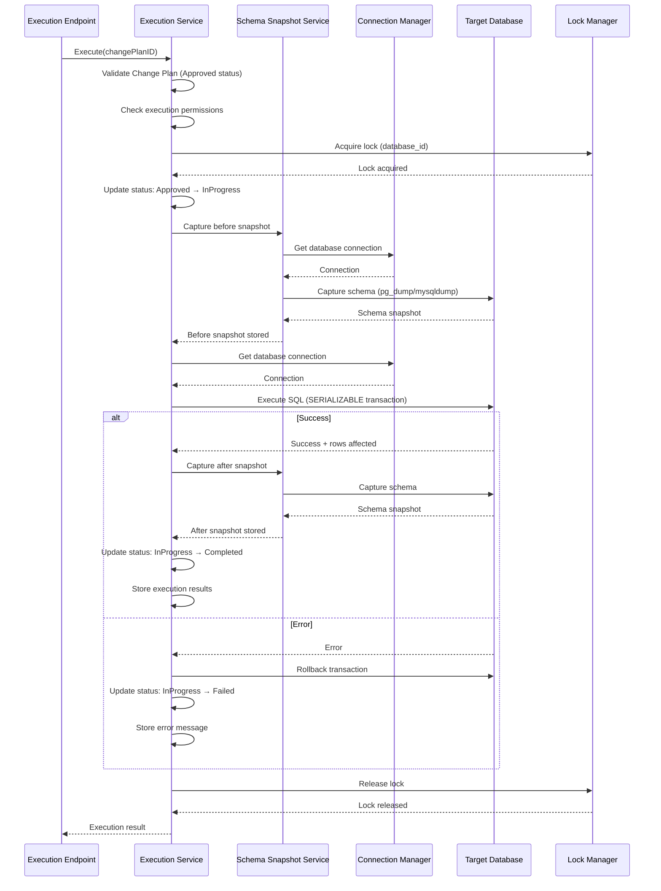
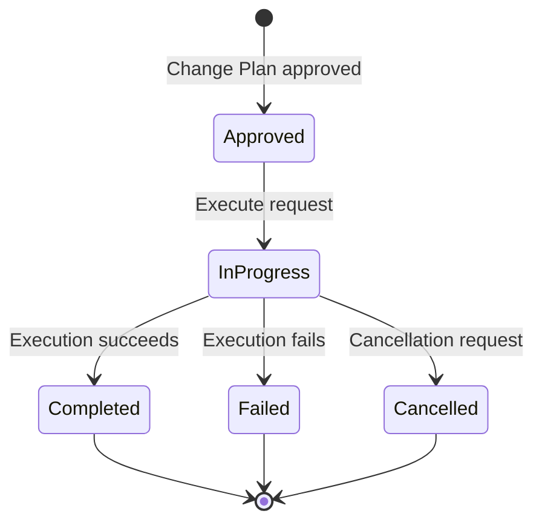

# Execution Engine Architecture

## Overview

The Execution Engine is responsible for safely executing approved Change Plans against target databases. It ensures transactional integrity, captures schema snapshots for audit and rollback purposes, manages concurrency to prevent conflicts, and provides comprehensive error handling and logging. The engine supports both MySQL and PostgreSQL databases.

## Execution Flow

### High-Level Flow



### State Transitions



## Execution Requirements

### Pre-Execution Validation

1. **Status Check**: Change Plan must be in `Approved` status
   - Error: `ErrChangePlanNotApproved` if status is not `Approved`

2. **Permission Check**: User must have execution permission
   - **Allowed Roles**:
     - Organization Admin
     - Organization DBA
     - Project Owner
     - Change Plan Author (the person who created it)
   - Error: `ErrUnauthorizedExecution` if user lacks permission

3. **Database Availability**: Target database must be active
   - Error: `ErrDatabaseInactive` if database status is not `Active`

4. **Concurrency Check**: No other Change Plan executing on same database
   - Error: `ErrDatabaseLocked` if database is locked by another execution

### Execution Permissions

Execution permissions are checked at two levels:

#### Organization-Level Permissions
- **Organization Admin**: Can execute any Change Plan in any project
- **Organization DBA**: Can execute any Change Plan in any project

#### Project-Level Permissions
- **Project Owner**: Can execute any Change Plan in their project
- **Change Plan Author**: Can execute their own Change Plans

#### Implementation

```go
// Execution permission check logic
func (s *ExecutionService) verifyExecutionPermission(
    ctx context.Context,
    changePlan *models.ChangePlan,
    executorID uuid.UUID,
) error {
    // Get user from context
    userIDStr, _, orgRole, ok := rbac.GetUserFromContext(ctx)
    if !ok {
        return ErrUnauthorizedExecution
    }

    userUUID, err := uuid.Parse(userIDStr)
    if err != nil {
        return ErrUnauthorizedExecution
    }

    // Verify executor ID matches authenticated user
    if userUUID != executorID {
        return ErrUnauthorizedExecution
    }

    // Check organization-level permissions
    if s.rbacChecker.HasOrganizationPermission(orgRole, rbac.PermissionChangesExecute) {
        return nil
    }

    // Check if user is the author
    if changePlan.AuthorID == executorID {
        return nil
    }

    // Check project-level permissions
    projectMember, err := s.projectMemberRepo.GetMemberRole(ctx, changePlan.ProjectID, executorID)
    if err != nil {
        return ErrUnauthorizedExecution
    }

    // Check if user is Project Owner
    if projectMember.Role == models.ProjectRoleOwner {
        return nil
    }

    return ErrUnauthorizedExecution
}
```

## Transaction Management Strategy

### Isolation Level: SERIALIZABLE

**Rationale**: SERIALIZABLE isolation ensures the highest level of isolation, preventing phantom reads, non-repeatable reads, and dirty reads. This is critical for database schema changes where consistency is paramount.

### Transaction Boundaries

1. **Transaction Start**: Before executing SQL
2. **Transaction Execution**: Execute all SQL statements within the transaction
3. **Transaction Commit**: On successful execution
4. **Transaction Rollback**: On any error

### Implementation Pattern

```go
// Transaction execution pattern
func (s *ExecutionService) executeInTransaction(
    ctx context.Context,
    db *sql.DB,
    sqlContent string,
) (*ExecutionResult, error) {
    // Begin transaction with SERIALIZABLE isolation
    tx, err := db.BeginTx(ctx, &sql.TxOptions{
        Isolation: sql.LevelSerializable,
    })
    if err != nil {
        return nil, fmt.Errorf("failed to begin transaction: %w", err)
    }

    // Defer rollback (will be no-op if commit succeeds)
    defer func() {
        if err != nil {
            tx.Rollback()
        }
    }()

    // Execute SQL statements
    startTime := time.Now()
    result, err := tx.ExecContext(ctx, sqlContent)
    if err != nil {
        return nil, fmt.Errorf("execution failed: %w", err)
    }

    // Get rows affected
    rowsAffected, err := result.RowsAffected()
    if err != nil {
        return nil, fmt.Errorf("failed to get rows affected: %w", err)
    }

    // Commit transaction
    if err := tx.Commit(); err != nil {
        return nil, fmt.Errorf("failed to commit transaction: %w", err)
    }

    duration := time.Since(startTime)

    return &ExecutionResult{
        Success:      true,
        RowsAffected: int(rowsAffected),
        Duration:     duration,
    }, nil
}
```

### Multi-Statement Support

- **Single Statement**: Execute directly
- **Multiple Statements**: Split by semicolon and execute sequentially within the same transaction
- **Maximum Statements**: Up to 100 statements per execution (configurable)
- **Error Handling**: If any statement fails, entire transaction is rolled back

### Transaction Timeout

- **Default Timeout**: 5 minutes (300 seconds)
- **Configurable**: Can be adjusted per Change Plan or globally
- **Timeout Behavior**: On timeout, transaction is rolled back and execution marked as Failed

## Schema Snapshot Capture Strategy

### Purpose

Schema snapshots serve multiple purposes:
1. **Audit Trail**: Record database state before and after changes
2. **Rollback Support**: Enable manual rollback if needed
3. **Change Verification**: Compare before/after to verify changes
4. **Compliance**: Meet regulatory requirements for change tracking

### Snapshot Timing

1. **Before Snapshot**: Captured immediately before SQL execution
2. **After Snapshot**: Captured immediately after successful execution (only if execution succeeds)

### Snapshot Methods

#### PostgreSQL

**Method**: `pg_dump --schema-only`
- **Command**: `pg_dump --host=<host> --port=<port> --username=<username> --schema-only --no-owner --no-privileges <database>`
- **Output Format**: SQL text (stored as BYTEA or TEXT)
- **Compression**: Optional (gzip compression before storage)

**Alternative**: Use `pg_catalog` queries (faster but less comprehensive)
- Query `information_schema` and `pg_catalog` for schema definition
- Construct SQL DDL statements programmatically

#### MySQL

**Method**: `mysqldump --no-data`
- **Command**: `mysqldump --host=<host> --port=<port> --user=<username> --no-data <database>`
- **Output Format**: SQL text (stored as BYTEA or TEXT)
- **Compression**: Optional (gzip compression before storage)

**Alternative**: Use `information_schema` queries (faster but less comprehensive)
- Query `information_schema` for schema definition
- Construct SQL DDL statements programmatically

### Snapshot Storage

**Database Schema**:
```sql
CREATE TABLE schema_snapshots (
    id UUID PRIMARY KEY DEFAULT gen_random_uuid(),
    change_plan_id UUID NOT NULL,
    target_database_id UUID NOT NULL,
    snapshot_type VARCHAR(50) NOT NULL, -- 'before' or 'after'
    snapshot_data BYTEA NOT NULL, -- Compressed schema dump
    snapshot_format VARCHAR(50) NOT NULL, -- 'sql' or 'json'
    compression_type VARCHAR(50), -- 'gzip', 'none', etc.
    created_at TIMESTAMP WITH TIME ZONE NOT NULL DEFAULT CURRENT_TIMESTAMP,
    
    CONSTRAINT check_snapshot_type CHECK (snapshot_type IN ('before', 'after')),
    CONSTRAINT fk_snapshots_change_plan FOREIGN KEY (change_plan_id) REFERENCES change_plans(id) ON DELETE CASCADE,
    CONSTRAINT fk_snapshots_database FOREIGN KEY (target_database_id) REFERENCES databases(id) ON DELETE CASCADE
);

CREATE INDEX idx_snapshots_change_plan ON schema_snapshots(change_plan_id);
CREATE INDEX idx_snapshots_database ON schema_snapshots(target_database_id);
CREATE INDEX idx_snapshots_type ON schema_snapshots(snapshot_type);
```

### Snapshot Compression

**Rationale**: Schema snapshots can be large (several MB for complex schemas). Compression reduces storage requirements.

**Strategy**:
- **Compression**: gzip compression by default
- **Decompression**: On retrieval, decompress before returning
- **Storage**: Store compressed data in BYTEA column
- **Metadata**: Store compression type in `compression_type` column

### Snapshot Capture Implementation

```go
// Schema snapshot capture interface
type SchemaSnapshotService interface {
    // CaptureBefore captures schema snapshot before execution
    CaptureBefore(ctx context.Context, changePlanID uuid.UUID, databaseID uuid.UUID) (*SchemaSnapshot, error)
    
    // CaptureAfter captures schema snapshot after successful execution
    CaptureAfter(ctx context.Context, changePlanID uuid.UUID, databaseID uuid.UUID) (*SchemaSnapshot, error)
    
    // GetSnapshot retrieves a stored snapshot
    GetSnapshot(ctx context.Context, snapshotID uuid.UUID) (*SchemaSnapshot, error)
    
    // GetSnapshotsByChangePlan retrieves all snapshots for a change plan
    GetSnapshotsByChangePlan(ctx context.Context, changePlanID uuid.UUID) ([]*SchemaSnapshot, error)
}

// SchemaSnapshot model
type SchemaSnapshot struct {
    ID              uuid.UUID
    ChangePlanID    uuid.UUID
    TargetDatabaseID uuid.UUID
    SnapshotType    SnapshotType // 'before' or 'after'
    SnapshotData    []byte       // Compressed schema dump
    SnapshotFormat  string       // 'sql' or 'json'
    CompressionType string       // 'gzip', 'none', etc.
    CreatedAt       time.Time
}
```

### Error Handling for Snapshots

**Failure Scenarios**:
1. **Connection Failure**: Database unreachable
   - Error: `ErrSnapshotConnectionFailed`
   - Behavior: Execution proceeds (snapshot failure is logged but doesn't block execution)

2. **Permission Failure**: Insufficient permissions for dump command
   - Error: `ErrSnapshotPermissionDenied`
   - Behavior: Execution proceeds (snapshot failure is logged but doesn't block execution)

3. **Timeout**: Snapshot capture takes too long
   - Error: `ErrSnapshotTimeout`
   - Behavior: Execution proceeds (snapshot failure is logged but doesn't block execution)

**Rationale**: Snapshot failures should not block execution. Execution is the critical path; snapshots are for audit/rollback purposes.

## Concurrency Control Strategy

### Lock Granularity: Database-Level (Deeb Application-Level)

**Rationale**: Only one Change Plan can execute on a database at a time. Different databases can execute concurrently. **Critical**: The lock is managed at the Deeb application level and does NOT lock the target database itself, allowing applications to continue reading/writing during Change Plan execution.

### Lock Mechanism: Application-Level Lock Table

**Key Design Decision**: Locks are stored in Deeb's own PostgreSQL database (not the target database). This ensures:
- ✅ Applications can continue reading/writing to target databases during execution
- ✅ No interference with application database connections
- ✅ Simple, consistent locking mechanism across all database types (MySQL, PostgreSQL)
- ✅ Easy to monitor and debug lock status

### Execution Locks Table

**Database Schema** (in Deeb's PostgreSQL database):
```sql
CREATE TABLE execution_locks (
    id UUID PRIMARY KEY DEFAULT gen_random_uuid(),
    target_database_id UUID NOT NULL UNIQUE,
    change_plan_id UUID NOT NULL,
    executor_id UUID NOT NULL,
    locked_at TIMESTAMP WITH TIME ZONE NOT NULL DEFAULT CURRENT_TIMESTAMP,
    expires_at TIMESTAMP WITH TIME ZONE NOT NULL,
    
    CONSTRAINT fk_execution_locks_change_plan FOREIGN KEY (change_plan_id) REFERENCES change_plans(id) ON DELETE CASCADE,
    CONSTRAINT fk_execution_locks_database FOREIGN KEY (target_database_id) REFERENCES databases(id) ON DELETE CASCADE,
    CONSTRAINT fk_execution_locks_executor FOREIGN KEY (executor_id) REFERENCES users(id) ON DELETE RESTRICT
);

CREATE INDEX idx_execution_locks_database ON execution_locks(target_database_id);
CREATE INDEX idx_execution_locks_expires_at ON execution_locks(expires_at);
```

### Lock Acquisition Strategy

**Method**: Use PostgreSQL `SELECT FOR UPDATE` with row-level locking in a transaction.

**Lock Key**: `target_database_id` (UUID of the target database)

**Implementation Pattern**:
```sql
-- Acquire lock (non-blocking attempt)
BEGIN;
SELECT * FROM execution_locks 
WHERE target_database_id = $1 
FOR UPDATE NOWAIT;

-- If no row exists, insert lock record
INSERT INTO execution_locks (target_database_id, change_plan_id, executor_id, expires_at)
VALUES ($1, $2, $3, NOW() + INTERVAL '1 hour')
ON CONFLICT (target_database_id) DO NOTHING
RETURNING id;

-- If insert succeeded, lock acquired
-- If insert failed (conflict), lock already held by another execution
COMMIT;
```

**Non-Blocking Attempt**:
```sql
-- Try to acquire lock with NOWAIT (immediate failure if locked)
SELECT * FROM execution_locks 
WHERE target_database_id = $1 
FOR UPDATE NOWAIT;

-- If query succeeds (no row or row returned), proceed to insert/update
-- If query fails with lock error, another execution is in progress
```

### Lock Timeout

- **Default Timeout**: 30 seconds (for lock acquisition attempt)
- **Lock Expiration**: 1 hour (maximum lock hold time, prevents stale locks)
- **Behavior**: If lock cannot be acquired within timeout, return `ErrDatabaseLocked`
- **Error Response**: HTTP 409 Conflict with message "Database is currently locked by another execution"

### Lock Lifecycle

1. **Lock Acquisition**: Before execution starts
   - Insert lock record in `execution_locks` table
   - Set `expires_at` to 1 hour from now
   - Use `SELECT FOR UPDATE NOWAIT` to prevent concurrent insertions

2. **Lock Hold**: During entire execution (including snapshot capture)
   - Lock record remains in `execution_locks` table
   - Other Change Plans attempting to execute on same database will see locked status

3. **Lock Release**: After execution completes (success or failure)
   - Delete lock record from `execution_locks` table
   - Ensures next Change Plan can execute

### Lock Release Strategy

**Guaranteed Release**:
- **Success**: Lock released after successful execution
- **Failure**: Lock released after failed execution
- **Panic**: Lock released via defer statement
- **Timeout**: Lock released on execution timeout
- **Stale Lock Cleanup**: Background job periodically cleans up expired locks (expires_at < NOW())

### Lock Cleanup Background Job

**Purpose**: Clean up stale locks from crashed or abandoned executions.

**Implementation**:
- **Frequency**: Run every 5 minutes
- **Query**: `DELETE FROM execution_locks WHERE expires_at < NOW()`
- **Result**: Automatically releases locks from crashed executions
- **Notification**: Log warning when cleaning up stale locks

### Concurrency Control Implementation

```go
// Lock manager interface
type ExecutionLockManager interface {
    // AcquireLock acquires execution lock for a database
    // Returns error if lock cannot be acquired (database already locked)
    AcquireLock(ctx context.Context, databaseID uuid.UUID, changePlanID uuid.UUID, executorID uuid.UUID) error
    
    // ReleaseLock releases execution lock for a database
    ReleaseLock(ctx context.Context, databaseID uuid.UUID) error
    
    // IsLocked checks if database is currently locked
    IsLocked(ctx context.Context, databaseID uuid.UUID) (bool, *ExecutionLock, error)
    
    // CleanupExpiredLocks removes expired locks (background job)
    CleanupExpiredLocks(ctx context.Context) (int, error)
}

// ExecutionLock represents a lock record
type ExecutionLock struct {
    ID              uuid.UUID
    TargetDatabaseID uuid.UUID
    ChangePlanID    uuid.UUID
    ExecutorID      uuid.UUID
    LockedAt        time.Time
    ExpiresAt       time.Time
}

// Lock acquisition implementation
func (m *executionLockManager) AcquireLock(
    ctx context.Context,
    databaseID uuid.UUID,
    changePlanID uuid.UUID,
    executorID uuid.UUID,
) error {
    // Use transaction with SELECT FOR UPDATE NOWAIT
    tx, err := m.db.BeginTxx(ctx, nil)
    if err != nil {
        return fmt.Errorf("failed to begin transaction: %w", err)
    }
    defer tx.Rollback()
    
    // Check if lock exists (non-blocking)
    var existingLock ExecutionLock
    err = tx.GetContext(ctx, &existingLock,
        "SELECT * FROM execution_locks WHERE target_database_id = $1 FOR UPDATE NOWAIT",
        databaseID,
    )
    
    if err == nil {
        // Lock exists - check if expired
        if time.Now().Before(existingLock.ExpiresAt) {
            return ErrDatabaseLocked
        }
        // Lock expired - delete it
        _, err = tx.ExecContext(ctx,
            "DELETE FROM execution_locks WHERE target_database_id = $1",
            databaseID,
        )
        if err != nil {
            return fmt.Errorf("failed to cleanup expired lock: %w", err)
        }
    } else if err != sql.ErrNoRows {
        // Check if error is lock contention (PostgreSQL error code 55P03)
        if isLockContentionError(err) {
            return ErrDatabaseLocked
        }
        return fmt.Errorf("failed to check lock: %w", err)
    }
    
    // Insert new lock record
    expiresAt := time.Now().Add(1 * time.Hour)
    _, err = tx.ExecContext(ctx,
        `INSERT INTO execution_locks (target_database_id, change_plan_id, executor_id, expires_at)
         VALUES ($1, $2, $3, $4)`,
        databaseID, changePlanID, executorID, expiresAt,
    )
    if err != nil {
        // Handle unique constraint violation (race condition)
        if isUniqueViolationError(err) {
            return ErrDatabaseLocked
        }
        return fmt.Errorf("failed to acquire lock: %w", err)
    }
    
    // Commit transaction
    if err := tx.Commit(); err != nil {
        return fmt.Errorf("failed to commit lock: %w", err)
    }
    
    return nil
}

// Lock release implementation
func (m *executionLockManager) ReleaseLock(
    ctx context.Context,
    databaseID uuid.UUID,
) error {
    result, err := m.db.ExecContext(ctx,
        "DELETE FROM execution_locks WHERE target_database_id = $1",
        databaseID,
    )
    if err != nil {
        return fmt.Errorf("failed to release lock: %w", err)
    }
    
    rowsAffected, err := result.RowsAffected()
    if err != nil {
        return fmt.Errorf("failed to get rows affected: %w", err)
    }
    
    if rowsAffected == 0 {
        m.logger.Warn("Attempted to release non-existent lock", zap.String("database_id", databaseID.String()))
    }
    
    return nil
}

// Execute with lock pattern
func (s *ExecutionService) executeWithLock(
    ctx context.Context,
    changePlan *models.ChangePlan,
    executorID uuid.UUID,
) error {
    // Acquire lock
    if err := s.lockManager.AcquireLock(ctx, changePlan.TargetDatabaseID, changePlan.ID, executorID); err != nil {
        if err == ErrDatabaseLocked {
            return ErrDatabaseLocked
        }
        return fmt.Errorf("failed to acquire lock: %w", err)
    }
    
    // Guarantee lock release
    defer func() {
        if err := s.lockManager.ReleaseLock(ctx, changePlan.TargetDatabaseID); err != nil {
            s.logger.Error("Failed to release execution lock", zap.Error(err))
        }
    }()
    
    // Execute Change Plan
    return s.executeChangePlan(ctx, changePlan)
}
```

### Benefits of Application-Level Locking

1. **No Application Impact**: Target databases remain fully accessible for reads/writes
2. **Cross-Database Compatible**: Works identically for MySQL and PostgreSQL targets
3. **Observable**: Lock status visible in Deeb's database for monitoring/debugging
4. **Resilient**: Stale locks automatically cleaned up by background job
5. **Simple**: Uses standard PostgreSQL row-level locking (SELECT FOR UPDATE)
6. **Fast**: Lock acquisition/release is a simple database operation in Deeb's database

### Execution Queue (Future Enhancement)

For P04M19, an execution queue will be implemented:
- **Queue Purpose**: Queue Change Plans when database is locked
- **Queue Position**: Report position in queue to user
- **Auto-Processing**: Process queued Change Plans when lock becomes available

## Error Handling Strategy

### Error Categories

#### 1. Validation Errors (Before Execution)

**Errors**:
- `ErrChangePlanNotFound`: Change Plan doesn't exist
- `ErrChangePlanNotApproved`: Change Plan not in Approved status
- `ErrUnauthorizedExecution`: User lacks execution permission
- `ErrDatabaseInactive`: Target database is inactive
- `ErrDatabaseLocked`: Database is locked by another execution

**HTTP Status**: 400 Bad Request (except 403 Forbidden for authorization, 409 Conflict for locked)

#### 2. Connection Errors

**Errors**:
- `ErrDatabaseConnectionFailed`: Cannot connect to target database
- `ErrConnectionTimeout`: Connection timeout
- `ErrInvalidCredentials`: Database credentials invalid

**HTTP Status**: 500 Internal Server Error

#### 3. Execution Errors

**Errors**:
- `ErrSQLExecutionFailed`: SQL execution failed (syntax error, constraint violation, etc.)
- `ErrTransactionRollbackFailed`: Transaction rollback failed (critical)
- `ErrExecutionTimeout`: Execution exceeded timeout

**HTTP Status**: 500 Internal Server Error

#### 4. Snapshot Errors

**Errors**:
- `ErrSnapshotConnectionFailed`: Cannot connect for snapshot
- `ErrSnapshotPermissionDenied`: Insufficient permissions for snapshot
- `ErrSnapshotTimeout`: Snapshot capture timeout

**HTTP Status**: 500 Internal Server Error (but execution continues)

### Error Handling Pattern

```go
// Error handling pattern
func (s *ExecutionService) Execute(
    ctx context.Context,
    changePlanID uuid.UUID,
    executorID uuid.UUID,
) (*ExecutionResult, error) {
    // Validation errors (return immediately)
    changePlan, err := s.changePlanRepo.GetByID(ctx, changePlanID)
    if err != nil {
        if err == repository.ErrNotFound {
            return nil, ErrChangePlanNotFound
        }
        return nil, fmt.Errorf("failed to get change plan: %w", err)
    }

    if changePlan.Status != models.ChangePlanStatusApproved {
        return nil, ErrChangePlanNotApproved
    }

    // Permission check (return immediately)
    if err := s.verifyExecutionPermission(ctx, changePlan, executorID); err != nil {
        return nil, err
    }

    // Acquire lock (return immediately if locked)
    if err := s.lockManager.AcquireLock(ctx, changePlan.TargetDatabaseID, changePlanID, executorID); err != nil {
        if err == ErrDatabaseLocked {
            return nil, ErrDatabaseLocked
        }
        return nil, fmt.Errorf("failed to acquire lock: %w", err)
    }
    defer s.lockManager.ReleaseLock(ctx, changePlan.TargetDatabaseID)

    // Update status to InProgress
    changePlan.Status = models.ChangePlanStatusInProgress
    changePlan.UpdatedAt = time.Now()
    if err := s.changePlanRepo.Update(ctx, changePlan); err != nil {
        return nil, fmt.Errorf("failed to update status: %w", err)
    }

    // Capture before snapshot (non-blocking)
    beforeSnapshot, snapshotErr := s.snapshotService.CaptureBefore(ctx, changePlanID, changePlan.TargetDatabaseID)
    if snapshotErr != nil {
        s.logger.Warn("Failed to capture before snapshot", zap.Error(snapshotErr))
        // Continue execution despite snapshot failure
    }

    // Execute SQL
    result, err := s.executeInTransaction(ctx, changePlan)
    if err != nil {
        // Execution failed
        changePlan.Status = models.ChangePlanStatusFailed
        changePlan.ErrorMessage = &[]string{err.Error()}[0]
        changePlan.UpdatedAt = time.Now()
        if updateErr := s.changePlanRepo.Update(ctx, changePlan); updateErr != nil {
            s.logger.Error("Failed to update status to Failed", zap.Error(updateErr))
        }
        
        return nil, fmt.Errorf("execution failed: %w", err)
    }

    // Execution succeeded
    // Capture after snapshot (non-blocking)
    afterSnapshot, snapshotErr := s.snapshotService.CaptureAfter(ctx, changePlanID, changePlan.TargetDatabaseID)
    if snapshotErr != nil {
        s.logger.Warn("Failed to capture after snapshot", zap.Error(snapshotErr))
        // Continue despite snapshot failure
    }

    // Update status to Completed
    changePlan.Status = models.ChangePlanStatusCompleted
    changePlan.ExecutedAt = &[]time.Time{time.Now()}[0]
    changePlan.ExecutionDurationMs = &[]int{int(result.Duration.Milliseconds())}[0]
    changePlan.AffectedRows = &result.RowsAffected
    changePlan.UpdatedAt = time.Now()
    if err := s.changePlanRepo.Update(ctx, changePlan); err != nil {
        return nil, fmt.Errorf("failed to update status to Completed: %w", err)
    }

    return result, nil
}
```

### Error Logging

**Structured Logging**:
- **Log Level**: Error for failures, Info for successful executions
- **Fields**: Change Plan ID, Database ID, Executor ID, Error message, Duration
- **Format**: JSON structured logs (using Zap)

**Example Log Entry**:
```json
{
  "level": "error",
  "msg": "Change plan execution failed",
  "change_plan_id": "123e4567-e89b-12d3-a456-426614174000",
  "database_id": "789e0123-e45b-67c8-d901-234567890abc",
  "executor_id": "456e7890-e12b-34c5-d678-901234567890",
  "error": "SQL execution failed: syntax error at or near \"CREATE\"",
  "duration_ms": 1250
}
```

### Error Response Format

```json
{
  "error": "Change plan execution failed",
  "change_plan_id": "123e4567-e89b-12d3-a456-426614174000",
  "status": "Failed",
  "error_message": "SQL execution failed: syntax error at or near \"CREATE\"",
  "execution_duration_ms": 1250
}
```

## Execution Result Capture

### Result Fields

- **Success**: Boolean indicating success/failure
- **RowsAffected**: Number of rows affected by execution
- **Duration**: Execution duration in milliseconds
- **ErrorMessage**: Error message if execution failed
- **ExecutedAt**: Timestamp of execution
- **SnapshotBeforeID**: ID of before snapshot (if captured)
- **SnapshotAfterID**: ID of after snapshot (if captured)

### Result Storage

**Change Plan Fields** (updated after execution):
- `executed_at`: Timestamp of execution
- `execution_duration_ms`: Duration in milliseconds
- `affected_rows`: Number of rows affected
- `error_message`: Error message (if failed)

**Execution History Table** (future enhancement):
- Store detailed execution history
- Track retries and multiple execution attempts
- Enable execution history API

## Service Architecture

### Execution Service Interface

```go
type ExecutionService interface {
    // Execute executes an approved Change Plan
    Execute(ctx context.Context, changePlanID uuid.UUID, executorID uuid.UUID) (*ExecutionResult, error)
    
    // GetExecutionStatus retrieves current execution status
    GetExecutionStatus(ctx context.Context, changePlanID uuid.UUID) (*ExecutionStatus, error)
    
    // CancelExecution cancels an in-progress execution
    CancelExecution(ctx context.Context, changePlanID uuid.UUID, executorID uuid.UUID) error
}
```

### Service Dependencies

The Execution Service depends on:

1. **ChangePlanRepository**: Updates Change Plan status
2. **DatabaseRepository**: Retrieves database connection details
3. **DatabaseInstanceRepository**: Retrieves database instance connection details
4. **ConnectionManager**: Manages database connections
5. **SchemaSnapshotService**: Captures schema snapshots
6. **ExecutionLockManager**: Manages execution locks
7. **ProjectMemberRepository**: Validates project-level permissions
8. **RBAC Service**: Validates organization-level permissions
9. **Logger**: Structured logging

### Execution Result Model

```go
type ExecutionResult struct {
    Success         bool
    RowsAffected    int
    Duration        time.Duration
    ErrorMessage    *string
    ExecutedAt      time.Time
    SnapshotBeforeID *uuid.UUID
    SnapshotAfterID  *uuid.UUID
}
```

## Database Schema

### Execution-Related Tables

#### change_plans Table (Existing)

Fields updated during execution:
- `status`: Updated to `InProgress`, then `Completed` or `Failed`
- `executed_at`: Set on execution start
- `execution_duration_ms`: Set on completion
- `affected_rows`: Set on completion
- `error_message`: Set on failure

#### schema_snapshots Table (New)

```sql
CREATE TABLE schema_snapshots (
    id UUID PRIMARY KEY DEFAULT gen_random_uuid(),
    change_plan_id UUID NOT NULL,
    target_database_id UUID NOT NULL,
    snapshot_type VARCHAR(50) NOT NULL,
    snapshot_data BYTEA NOT NULL,
    snapshot_format VARCHAR(50) NOT NULL,
    compression_type VARCHAR(50),
    created_at TIMESTAMP WITH TIME ZONE NOT NULL DEFAULT CURRENT_TIMESTAMP,
    
    CONSTRAINT check_snapshot_type CHECK (snapshot_type IN ('before', 'after')),
    CONSTRAINT fk_snapshots_change_plan FOREIGN KEY (change_plan_id) REFERENCES change_plans(id) ON DELETE CASCADE,
    CONSTRAINT fk_snapshots_database FOREIGN KEY (target_database_id) REFERENCES databases(id) ON DELETE CASCADE
);

CREATE INDEX idx_snapshots_change_plan ON schema_snapshots(change_plan_id);
CREATE INDEX idx_snapshots_database ON schema_snapshots(target_database_id);
CREATE INDEX idx_snapshots_type ON schema_snapshots(snapshot_type);
```

#### execution_locks Table (New)

```sql
CREATE TABLE execution_locks (
    id UUID PRIMARY KEY DEFAULT gen_random_uuid(),
    target_database_id UUID NOT NULL UNIQUE,
    change_plan_id UUID NOT NULL,
    executor_id UUID NOT NULL,
    locked_at TIMESTAMP WITH TIME ZONE NOT NULL DEFAULT CURRENT_TIMESTAMP,
    expires_at TIMESTAMP WITH TIME ZONE NOT NULL,
    
    CONSTRAINT fk_execution_locks_change_plan FOREIGN KEY (change_plan_id) REFERENCES change_plans(id) ON DELETE CASCADE,
    CONSTRAINT fk_execution_locks_database FOREIGN KEY (target_database_id) REFERENCES databases(id) ON DELETE CASCADE,
    CONSTRAINT fk_execution_locks_executor FOREIGN KEY (executor_id) REFERENCES users(id) ON DELETE RESTRICT
);

CREATE INDEX idx_execution_locks_database ON execution_locks(target_database_id);
CREATE INDEX idx_execution_locks_expires_at ON execution_locks(expires_at);
```

**Note**: This table stores application-level locks in Deeb's PostgreSQL database. It does NOT lock the target databases themselves, allowing applications to continue reading/writing during Change Plan execution.

## Future Enhancements

1. **Execution Queue**: Queue Change Plans when database is locked (P04M19)
2. **Retry Logic**: Automatic retry for transient failures
3. **Execution History**: Detailed execution history tracking
4. **Dry-Run Mode**: Preview execution without applying changes
5. **Scheduled Execution**: Execute Change Plans at specific times
6. **Multi-Stage Promotion**: Promote changes from Staging to Production
7. **Rollback Support**: Automatic rollback using captured snapshots

## Implementation Notes

- Execution service should be created in `backend/internal/services/execution_service.go`
- Service should use dependency injection for all dependencies
- All database operations should be wrapped in transactions for consistency
- Error messages should be user-friendly and actionable
- Logging should be comprehensive for audit purposes
- Schema snapshots should be compressed to reduce storage requirements
- Lock management should use application-level locking in Deeb's database (not target database locks)

