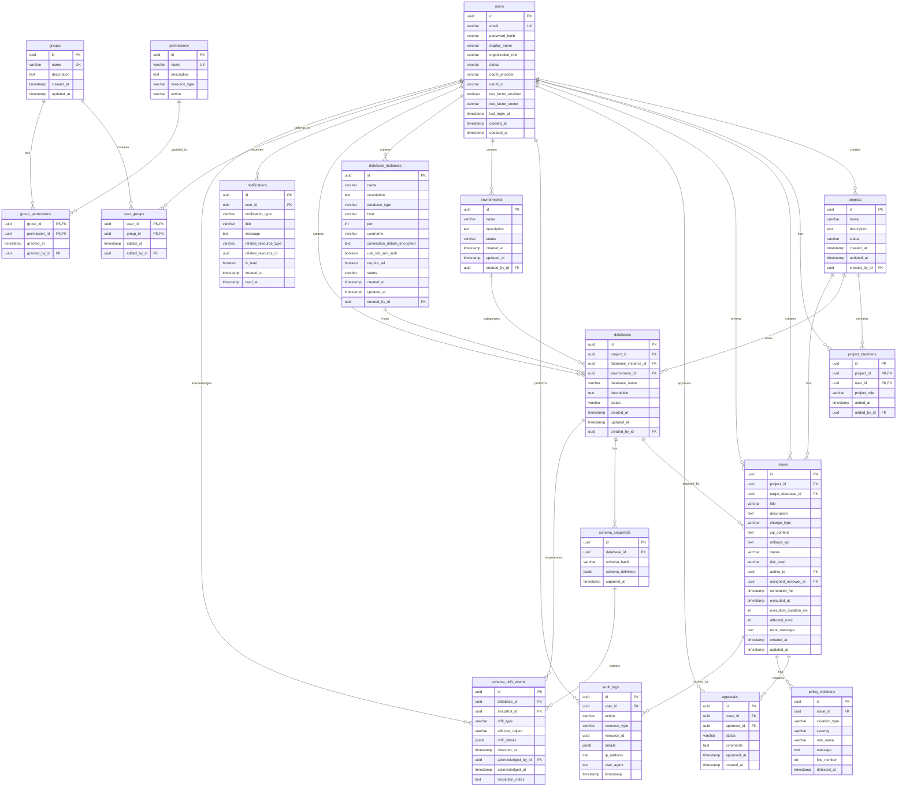

# Database Schema - Entity Relationship Diagram

## Overview

This document describes the database schema for the Deeb metadata database, which stores all application data including users, database change requests (issues), approvals, audit logs, and environment configurations.

## Entity Relationship Diagram

## Table Descriptions

### Core Tables

#### users
Stores user accounts with authentication details and organization-level role information.
- **Primary Key**: `id` (UUID)
- **Unique Constraints**: `email`
- **Organization Roles**: OrganizationAdmin, OrganizationDBA, OrganizationDeveloper
- **Key Features**:
  - Supports both password-based and OAuth authentication (Google, GitHub)
  - Built-in 2FA support with TOTP secrets
  - Organization-level role-based access control
  - Soft delete capability via status field

#### projects
Stores projects for organizing database change requests.
- **Primary Key**: `id` (UUID)
- **Foreign Keys**: `created_by_id` → users(id)
- **Key Features**:
  - Groups related database changes together
  - Status tracking (Active, Archived)
  - Project-level access control through project_members

#### project_members
Stores project-level role assignments for users.
- **Primary Key**: `id` (UUID)
- **Foreign Keys**:
  - `project_id` → projects(id)
  - `user_id` → users(id)
  - `added_by_id` → users(id)
- **Unique Constraints**: `(project_id, user_id)` - one role per user per project
- **Project Roles**: ProjectOwner, ProjectDeveloper, ProjectApprover, ProjectViewer
- **Key Features**:
  - Project-level permissions separate from organization roles
  - Audit trail (who added user to project)
  - Users can have different roles in different projects

#### environments
Stores environment stages (Dev, Staging, Production) - organization-level labels.
- **Primary Key**: `id` (UUID)
- **Foreign Keys**: `created_by_id` → users(id)
- **Key Features**:
  - Simple environment labels/stages
  - Organization-wide resource (not project-specific)
  - Used to categorize databases by deployment stage
  - Can have environment-specific policies attached

#### database_instances
Stores database server/cluster connection details - organization-level resources.
- **Primary Key**: `id` (UUID)
- **Foreign Keys**: `created_by_id` → users(id)
- **Key Features**:
  - Represents actual MySQL/PostgreSQL servers or clusters
  - Connection details (host, port, credentials)
  - Supports MySQL and PostgreSQL
  - Encrypted connection details storage
  - RDS IAM authentication support
  - SSL enforcement capability
  - Can host multiple databases
  - Managed by Organization Admins and DBAs

#### databases
Individual databases within instances, belonging to projects.
- **Primary Key**: `id` (UUID)
- **Foreign Keys**:
  - `project_id` → projects(id)
  - `database_instance_id` → database_instances(id)
  - `environment_id` → environments(id)
  - `created_by_id` → users(id)
- **Unique Constraints**: `(database_instance_id, database_name)` - unique database name per instance
- **Key Features**:
  - **Each database belongs to exactly one project**
  - Links a project to a specific database on an instance
  - Categorized by environment (Dev/Staging/Prod)
  - What developers primarily interact with
  - Clear ownership and access boundaries

#### issues
Stores database change requests with full lifecycle tracking.
- **Primary Key**: `id` (UUID)
- **Foreign Keys**:
  - `project_id` → projects(id)
  - `target_database_id` → databases(id)
  - `author_id` → users(id)
  - `assigned_reviewer_id` → users(id)
- **Key Features**:
  - Belongs to a specific project
  - Targets a specific database (not just an environment)
  - DDL and DML change support
  - Optional rollback scripts
  - Risk level classification (Low, Medium, High, Critical)
  - Scheduled execution support
  - Execution metrics tracking

### Compliance & Audit Tables

#### approvals
Tracks multi-step approval workflow for issues.
- **Primary Key**: `id` (UUID)
- **Foreign Keys**:
  - `issue_id` → issues(id)
  - `approver_id` → users(id)
- **Unique Constraints**: `(issue_id, approver_id)` - prevents duplicate approvals
- **Key Features**:
  - Supports Approved, Rejected, Pending statuses
  - Comments for approval decisions
  - Timestamp tracking

#### audit_logs
Complete audit trail of all user actions for compliance.
- **Primary Key**: `id` (UUID)
- **Foreign Keys**: `user_id` → users(id)
- **Key Features**:
  - Tracks all CRUD operations
  - Stores IP address and user agent
  - JSONB details field for flexible metadata
  - GIN index for efficient JSON queries

#### policy_violations
Automated policy validation results for issues.
- **Primary Key**: `id` (UUID)
- **Foreign Keys**: `issue_id` → issues(id)
- **Key Features**:
  - Multiple violation types (syntax, security, performance, compatibility, best practices)
  - Severity levels (Info, Warning, Error, Critical)
  - Line number tracking for precise error location

### Schema Drift Detection Tables

#### schema_snapshots
Periodic snapshots of database schemas for drift detection.
- **Primary Key**: `id` (UUID)
- **Foreign Keys**: `database_id` → databases(id)
- **Key Features**:
  - SHA256 hash for quick comparison
  - JSONB schema definition for detailed structure
  - Time-series data for historical tracking
  - Per-database snapshots (not per environment)

#### schema_drift_events
Records detected schema drift incidents.
- **Primary Key**: `id` (UUID)
- **Foreign Keys**:
  - `database_id` → databases(id)
  - `snapshot_id` → schema_snapshots(id)
  - `acknowledged_by_id` → users(id)
- **Key Features**:
  - Detailed drift type classification
  - JSONB diff details
  - Acknowledgment workflow
  - Resolution notes
  - Tracks drift for specific databases

### RBAC Tables

#### groups
User groups for role-based access control.
- **Primary Key**: `id` (UUID)
- **Unique Constraints**: `name`
- **Seed Data**: Developers, Approvers, Administrators

#### user_groups
Many-to-many relationship between users and groups.
- **Primary Key**: `(user_id, group_id)`
- **Foreign Keys**:
  - `user_id` → users(id)
  - `group_id` → groups(id)
  - `added_by_id` → users(id)
- **Key Features**:
  - Audit trail (who added user to group)
  - Timestamp tracking

#### permissions
System-level permissions for resources and actions.
- **Primary Key**: `id` (UUID)
- **Unique Constraints**: `(resource_type, action)`
- **Seed Data**: Pre-populated with all system permissions
- **Resource Types**: issue, user, environment, audit_log
- **Actions**: create, read, update, delete, approve, execute

#### group_permissions
Permissions assigned to groups.
- **Primary Key**: `(group_id, permission_id)`
- **Foreign Keys**:
  - `group_id` → groups(id)
  - `permission_id` → permissions(id)
  - `granted_by_id` → users(id)
- **Key Features**:
  - Audit trail (who granted permission)
  - Timestamp tracking

### Notification Table

#### notifications
User notifications for important events.
- **Primary Key**: `id` (UUID)
- **Foreign Keys**: `user_id` → users(id)
- **Key Features**:
  - Multiple notification types
  - Read/unread tracking
  - Links to related resources
  - Optimized index for unread notifications

## Indexing Strategy

### Performance Indexes
- **Foreign Keys**: All foreign key columns have indexes for efficient joins
- **Status Fields**: Status columns indexed for common filtering operations
- **Timestamps**: Created/updated timestamps indexed for time-based queries
- **Composite Indexes**: Multi-column indexes for common query patterns (e.g., unread notifications per user)

### Search Indexes
- **GIN Indexes**: JSON columns (audit_logs.details) use GIN indexes for efficient searching
- **Email Lookup**: Users table has index on email for login operations
- **OAuth Lookup**: Composite index on (oauth_provider, oauth_id) for OAuth authentication

## Data Integrity

### Constraints
- **Foreign Keys**: ON DELETE RESTRICT for critical references (prevent accidental deletion)
- **Foreign Keys**: ON DELETE CASCADE for dependent data (cleanup orphaned records)
- **CHECK Constraints**: Enum-like validation for status fields, email format validation
- **UNIQUE Constraints**: Prevent duplicate approvals, duplicate permission assignments

### Triggers
- **updated_at Trigger**: Automatically updates timestamp on row modifications
- Applied to: users, environments, issues, groups

## Security Considerations

1. **Password Storage**: Passwords stored as bcrypt hashes, never plain text
2. **Encrypted Connections**: connection_details_encrypted field stores sensitive connection info
3. **2FA Support**: Built-in TOTP secret storage for two-factor authentication
4. **Audit Trail**: Complete logging of all user actions with IP and user agent
5. **Soft Deletes**: User status field allows deactivation without data loss

## Data Types

- **UUIDs**: Primary keys use UUID v4 for distributed system compatibility
- **Timestamps**: All timestamps use TIMESTAMP WITH TIME ZONE for timezone awareness
- **JSONB**: Flexible metadata storage with indexing support
- **INET**: Native IP address type for audit logs
- **VARCHAR**: Length-limited text fields with appropriate sizes
- **TEXT**: Unlimited text for SQL content, descriptions, and error messages

## Scalability Considerations

1. **Partitioning**: audit_logs and schema_snapshots tables are candidates for time-based partitioning
2. **Archival**: Old completed issues can be archived after retention period
3. **Indexing**: Strategic indexes balance query performance vs. write overhead
4. **JSONB**: Flexible schema allows evolution without migrations for metadata fields
