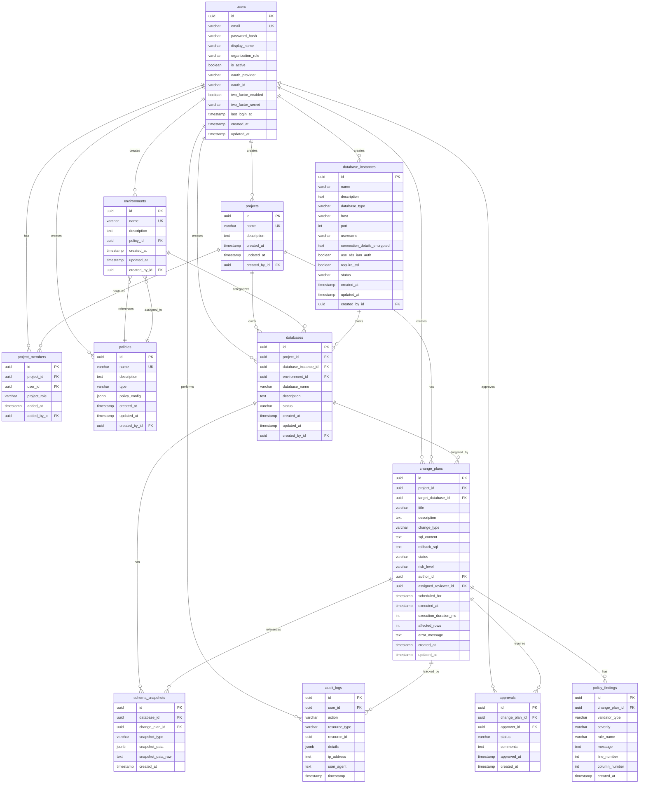

# Database Schema Design - Deeb MVP2

## Overview

This document describes the complete PostgreSQL database schema for Deeb MVP2, aligned with refined project definitions from `docs/project.md`. The schema implements a fresh foundation that supports Change Plans (instead of Issues), Policy management with type system, and comprehensive audit trails.

## Entity Relationship Diagram

## Core Tables

### users

Stores user accounts with authentication details and organization-level role information.

**Columns:**
- `id` (UUID, PRIMARY KEY): Unique identifier
- `email` (VARCHAR(255), UNIQUE, NOT NULL): User email address
- `password_hash` (VARCHAR(255), NULLABLE): Bcrypt hash for password-based auth (NULL for OAuth-only)
- `display_name` (VARCHAR(255), NULLABLE): User's display name
- `organization_role` (VARCHAR(50), NOT NULL, DEFAULT 'OrganizationDeveloper'): Organization-level role
  - Values: `OrganizationAdmin`, `OrganizationDBA`, `OrganizationDeveloper`
- `is_active` (BOOLEAN, NOT NULL, DEFAULT true): Account active status
- `oauth_provider` (VARCHAR(50), NULLABLE): OAuth provider name (`google`, `github`, or NULL)
- `oauth_id` (VARCHAR(255), NULLABLE): OAuth provider's user ID
- `two_factor_enabled` (BOOLEAN, DEFAULT false): 2FA enabled flag (Phase 3+)
- `two_factor_secret` (VARCHAR(255), NULLABLE): TOTP secret for 2FA (Phase 3+)
- `last_login_at` (TIMESTAMP WITH TIME ZONE, NULLABLE): Last login timestamp
- `created_at` (TIMESTAMP WITH TIME ZONE, NOT NULL, DEFAULT CURRENT_TIMESTAMP)
- `updated_at` (TIMESTAMP WITH TIME ZONE, NOT NULL, DEFAULT CURRENT_TIMESTAMP)

**Constraints:**
- `check_email_format`: Email format validation regex
- `check_organization_role`: Enum-like validation for organization roles

**Indexes:**
- `idx_users_email`: Email lookup for authentication
- `idx_users_oauth`: Composite index on `(oauth_provider, oauth_id)` for OAuth lookup
- `idx_users_is_active`: Filter active users
- `idx_users_organization_role`: Filter by organization role

**Foreign Keys:**
- None (root table)

---

### projects

Stores projects for organizing database changes and team members.

**Columns:**
- `id` (UUID, PRIMARY KEY): Unique identifier
- `name` (VARCHAR(100), NOT NULL, UNIQUE): Project name
- `description` (TEXT, NULLABLE): Project description
- `created_by_id` (UUID, NOT NULL): User who created the project
- `created_at` (TIMESTAMP WITH TIME ZONE, NOT NULL, DEFAULT CURRENT_TIMESTAMP)
- `updated_at` (TIMESTAMP WITH TIME ZONE, NOT NULL, DEFAULT CURRENT_TIMESTAMP)

**Constraints:**
- `unique_project_name`: Unique constraint on `name`

**Indexes:**
- `idx_projects_name`: Name lookup
- `idx_projects_created_by`: Filter by creator

**Foreign Keys:**
- `fk_projects_created_by` → `users(id)` ON DELETE RESTRICT

**Note:** Status field removed per PRD refinement (no status tracking for projects in MVP2).

---

### project_members

Stores project-level role assignments for users.

**Columns:**
- `id` (UUID, PRIMARY KEY): Unique identifier
- `project_id` (UUID, NOT NULL): Project reference
- `user_id` (UUID, NOT NULL): User reference
- `project_role` (VARCHAR(50), NOT NULL): Project-level role
  - Values: `ProjectOwner`, `ProjectDeveloper`, `ProjectApprover`, `ProjectViewer`
- `added_at` (TIMESTAMP WITH TIME ZONE, NOT NULL, DEFAULT CURRENT_TIMESTAMP)
- `added_by_id` (UUID, NOT NULL): User who added this member

**Constraints:**
- `check_project_role`: Enum-like validation for project roles
- `unique_project_user`: Unique constraint on `(project_id, user_id)` - one role per user per project

**Indexes:**
- `idx_project_members_project`: Filter by project
- `idx_project_members_user`: Filter by user
- `idx_project_members_role`: Filter by role

**Foreign Keys:**
- `fk_project_members_project` → `projects(id)` ON DELETE CASCADE
- `fk_project_members_user` → `users(id)` ON DELETE CASCADE
- `fk_project_members_added_by` → `users(id)` ON DELETE RESTRICT

---

### environments

Stores environment stages (Dev, Staging, Production) - organization-level labels.

**Columns:**
- `id` (UUID, PRIMARY KEY): Unique identifier
- `name` (VARCHAR(100), NOT NULL, UNIQUE): Environment name (e.g., "Development", "Staging", "Production")
- `description` (TEXT, NULLABLE): Environment description
- `policy_id` (UUID, NULLABLE): Reference to Policy (SQL_REVIEW type) for this environment
- `created_by_id` (UUID, NOT NULL): User who created the environment
- `created_at` (TIMESTAMP WITH TIME ZONE, NOT NULL, DEFAULT CURRENT_TIMESTAMP)
- `updated_at` (TIMESTAMP WITH TIME ZONE, NOT NULL, DEFAULT CURRENT_TIMESTAMP)

**Constraints:**
- `unique_environment_name`: Unique constraint on `name`

**Indexes:**
- `idx_environments_name`: Name lookup
- `idx_environments_policy`: Filter by policy
- `idx_environments_created_by`: Filter by creator

**Foreign Keys:**
- `fk_environments_policy` → `policies(id)` ON DELETE SET NULL (nullable, allows environment without policy)
- `fk_environments_created_by` → `users(id)` ON DELETE RESTRICT

**Note:** Status field removed per PRD refinement. Policy assignment enables environment-specific SQL Review policies.

---

### policies

Stores Policy configurations (SQL_REVIEW type and future types) that can be referenced by Environments.

**Columns:**
- `id` (UUID, PRIMARY KEY): Unique identifier
- `name` (VARCHAR(100), NOT NULL, UNIQUE): Policy name
- `description` (TEXT, NULLABLE): Policy description
- `type` (VARCHAR(50), NOT NULL): Policy type enum
  - Values: `SQL_REVIEW` (MVP2), extensible for future types
- `policy_config` (JSONB, NOT NULL): Policy configuration JSON
  - For SQL_REVIEW type: Contains validator settings (enabled/disabled validators, thresholds, etc.)
- `created_by_id` (UUID, NOT NULL): User who created the policy
- `created_at` (TIMESTAMP WITH TIME ZONE, NOT NULL, DEFAULT CURRENT_TIMESTAMP)
- `updated_at` (TIMESTAMP WITH TIME ZONE, NOT NULL, DEFAULT CURRENT_TIMESTAMP)

**Constraints:**
- `check_policy_type`: Enum-like validation for policy types
- `unique_policy_name`: Unique constraint on `name`

**Indexes:**
- `idx_policies_name`: Name lookup
- `idx_policies_type`: Filter by type (for SQL_REVIEW filtering)
- `idx_policies_created_by`: Filter by creator
- `idx_policies_config`: GIN index on `policy_config` JSONB for efficient querying

**Foreign Keys:**
- `fk_policies_created_by` → `users(id)` ON DELETE RESTRICT

**Usage:** Policies are managed by Admins and assigned to Environments. SQL Review engine loads Policy (SQL_REVIEW type) from Environment when reviewing Change Plans.

---

### database_instances

Stores database server/cluster connection details - organization-level resources.

**Columns:**
- `id` (UUID, PRIMARY KEY): Unique identifier
- `name` (VARCHAR(100), NOT NULL): Instance name
- `description` (TEXT, NULLABLE): Instance description
- `database_type` (VARCHAR(50), NOT NULL): Database type
  - Values: `mysql`, `postgresql`
- `host` (VARCHAR(255), NOT NULL): Database host address
- `port` (INTEGER, NOT NULL): Database port
- `username` (VARCHAR(255), NOT NULL): Database username
- `connection_details_encrypted` (TEXT, NULLABLE): Encrypted JSON with connection parameters (password, SSL certs, etc.)
- `use_rds_iam_auth` (BOOLEAN, DEFAULT false): Use RDS IAM authentication
- `require_ssl` (BOOLEAN, DEFAULT true): Require SSL connection
- `status` (VARCHAR(50), NOT NULL, DEFAULT 'Active'): Instance status
  - Values: `Active`, `Inactive`, `Maintenance`
- `created_by_id` (UUID, NOT NULL): User who created the instance
- `created_at` (TIMESTAMP WITH TIME ZONE, NOT NULL, DEFAULT CURRENT_TIMESTAMP)
- `updated_at` (TIMESTAMP WITH TIME ZONE, NOT NULL, DEFAULT CURRENT_TIMESTAMP)

**Constraints:**
- `check_database_type`: Enum-like validation for database types
- `check_instance_status`: Enum-like validation for instance status

**Indexes:**
- `idx_instances_status`: Filter by status
- `idx_instances_name`: Name lookup
- `idx_instances_type`: Filter by database type
- `idx_instances_created_by`: Filter by creator

**Foreign Keys:**
- `fk_instances_created_by` → `users(id)` ON DELETE RESTRICT

---

### databases

Individual databases within instances, belonging to projects.

**Columns:**
- `id` (UUID, PRIMARY KEY): Unique identifier
- `project_id` (UUID, NOT NULL): Project that owns this database
- `database_instance_id` (UUID, NOT NULL): Database instance hosting this database
- `environment_id` (UUID, NOT NULL): Environment this database belongs to
- `database_name` (VARCHAR(255), NOT NULL): Actual database name on the instance
- `description` (TEXT, NULLABLE): Database description
- `status` (VARCHAR(50), NOT NULL, DEFAULT 'Active'): Database status
  - Values: `Active`, `Inactive`
- `created_by_id` (UUID, NOT NULL): User who created the database
- `created_at` (TIMESTAMP WITH TIME ZONE, NOT NULL, DEFAULT CURRENT_TIMESTAMP)
- `updated_at` (TIMESTAMP WITH TIME ZONE, NOT NULL, DEFAULT CURRENT_TIMESTAMP)

**Constraints:**
- `check_database_status`: Enum-like validation for database status
- `unique_database_per_instance`: Unique constraint on `(database_instance_id, database_name)` - unique database name per instance

**Indexes:**
- `idx_databases_project`: Filter by project
- `idx_databases_instance`: Filter by instance
- `idx_databases_environment`: Filter by environment
- `idx_databases_status`: Filter by status
- `idx_databases_created_by`: Filter by creator

**Foreign Keys:**
- `fk_databases_project` → `projects(id)` ON DELETE CASCADE
- `fk_databases_instance` → `database_instances(id)` ON DELETE RESTRICT
- `fk_databases_environment` → `environments(id)` ON DELETE RESTRICT
- `fk_databases_created_by` → `users(id)` ON DELETE RESTRICT

**Note:** Each database belongs to exactly one Project and one Environment.

---

### change_plans

Stores database change requests with full lifecycle tracking. Replaces "issues" from original schema.

**Columns:**
- `id` (UUID, PRIMARY KEY): Unique identifier
- `project_id` (UUID, NOT NULL): Project this change plan belongs to
- `target_database_id` (UUID, NOT NULL): Target database for this change
- `title` (VARCHAR(255), NOT NULL): Change plan title
- `description` (TEXT, NOT NULL): Change plan description
- `change_type` (VARCHAR(50), NOT NULL): Type of change
  - Values: `DDL` (Data Definition Language), `DML` (Data Manipulation Language)
- `sql_content` (TEXT, NOT NULL): SQL statements to execute
- `rollback_sql` (TEXT, NULLABLE): Optional rollback SQL script
- `status` (VARCHAR(50), NOT NULL, DEFAULT 'Draft'): Change plan status
  - Values: `Draft`, `Open`, `Approved`, `Closed`, `Executed`, `Failed`
- `risk_level` (VARCHAR(50), NOT NULL, DEFAULT 'Medium'): Risk level (auto-assigned)
  - Values: `Low`, `Medium`, `High`
- `author_id` (UUID, NOT NULL): User who created the change plan
- `assigned_reviewer_id` (UUID, NULLABLE): Optional assigned reviewer
- `scheduled_for` (TIMESTAMP WITH TIME ZONE, NULLABLE): Scheduled execution time (NULL for immediate, Phase 2+)
- `executed_at` (TIMESTAMP WITH TIME ZONE, NULLABLE): Execution timestamp
- `execution_duration_ms` (INTEGER, NULLABLE): Execution duration in milliseconds
- `affected_rows` (INTEGER, NULLABLE): Number of rows affected
- `error_message` (TEXT, NULLABLE): Error details if execution failed
- `created_at` (TIMESTAMP WITH TIME ZONE, NOT NULL, DEFAULT CURRENT_TIMESTAMP)
- `updated_at` (TIMESTAMP WITH TIME ZONE, NOT NULL, DEFAULT CURRENT_TIMESTAMP)

**Constraints:**
- `check_change_type`: Enum-like validation for change types
- `check_change_plan_status`: Enum-like validation for status values
- `check_risk_level`: Enum-like validation for risk levels

**Indexes:**
- `idx_change_plans_project`: Filter by project
- `idx_change_plans_database`: Filter by target database
- `idx_change_plans_status`: Filter by status
- `idx_change_plans_author`: Filter by author
- `idx_change_plans_reviewer`: Partial index on `assigned_reviewer_id` WHERE NOT NULL
- `idx_change_plans_scheduled`: Partial index on `scheduled_for` WHERE NOT NULL
- `idx_change_plans_created_at`: Time-based queries (DESC)
- `idx_change_plans_risk_level`: Filter by risk level

**Foreign Keys:**
- `fk_change_plans_project` → `projects(id)` ON DELETE CASCADE
- `fk_change_plans_database` → `databases(id)` ON DELETE RESTRICT
- `fk_change_plans_author` → `users(id)` ON DELETE RESTRICT
- `fk_change_plans_reviewer` → `users(id)` ON DELETE SET NULL

**Status Lifecycle:**
1. `Draft`: Change plan created but not submitted
2. `Open`: Change plan submitted (SQL Review runs automatically)
3. `Approved`: Approved by approver (no SQL Review errors)
4. `Closed`: Rejected/closed by approver
5. `Executed`: Successfully executed against database
6. `Failed`: Execution failed (transaction rolled back)

---

### policy_findings

Stores SQL Review findings (results) from policy evaluation. Replaces "policy_violations" from original schema.

**Columns:**
- `id` (UUID, PRIMARY KEY): Unique identifier
- `change_plan_id` (UUID, NOT NULL): Change plan this finding belongs to
- `validator_type` (VARCHAR(100), NOT NULL): Type of validator that found this issue
  - Values: `syntax_error`, `security_risk`, `performance_issue`, `backwards_incompatible`, `best_practice_violation`
- `severity` (VARCHAR(50), NOT NULL): Finding severity
  - Values: `Error`, `Warning`, `Info`
- `rule_name` (VARCHAR(255), NOT NULL): Name of the rule that triggered this finding
- `message` (TEXT, NOT NULL): Human-readable finding message
- `line_number` (INTEGER, NULLABLE): Line number in SQL content where finding occurs
- `column_number` (INTEGER, NULLABLE): Column number in SQL content where finding occurs
- `created_at` (TIMESTAMP WITH TIME ZONE, NOT NULL, DEFAULT CURRENT_TIMESTAMP)

**Constraints:**
- `check_validator_type`: Enum-like validation for validator types
- `check_severity`: Enum-like validation for severity levels

**Indexes:**
- `idx_policy_findings_change_plan`: Filter by change plan
- `idx_policy_findings_severity`: Filter by severity (for error counting)
- `idx_policy_findings_validator_type`: Filter by validator type

**Foreign Keys:**
- `fk_policy_findings_change_plan` → `change_plans(id)` ON DELETE CASCADE

**Usage:** Findings are created when SQL Review runs on a Change Plan. Errors block approval/execution, warnings are shown but don't block.

---

### approvals

Stores approval/rejection records for change plans.

**Columns:**
- `id` (UUID, PRIMARY KEY): Unique identifier
- `change_plan_id` (UUID, NOT NULL): Change plan being approved/rejected
- `approver_id` (UUID, NOT NULL): User approving/rejecting
- `status` (VARCHAR(50), NOT NULL): Approval status
  - Values: `Approved`, `Rejected`
- `comments` (TEXT, NULLABLE): Optional comments from approver
- `approved_at` (TIMESTAMP WITH TIME ZONE, NULLABLE): Approval timestamp (NULL for rejected)
- `created_at` (TIMESTAMP WITH TIME ZONE, NOT NULL, DEFAULT CURRENT_TIMESTAMP)

**Constraints:**
- `check_approval_status`: Enum-like validation for approval status
- `unique_approval_per_user_change_plan`: Unique constraint on `(change_plan_id, approver_id)` - prevents duplicate approvals

**Indexes:**
- `idx_approvals_change_plan`: Filter by change plan
- `idx_approvals_approver`: Filter by approver
- `idx_approvals_status`: Filter by status
- `idx_approvals_created_at`: Time-based queries (DESC)

**Foreign Keys:**
- `fk_approvals_change_plan` → `change_plans(id)` ON DELETE CASCADE
- `fk_approvals_approver` → `users(id)` ON DELETE RESTRICT

**Usage:** Simple 1-approver flow for MVP2. Multi-stage approval deferred to Phase 2+.

---

### audit_logs

Stores complete audit trail of all user actions for compliance.

**Columns:**
- `id` (UUID, PRIMARY KEY): Unique identifier
- `user_id` (UUID, NOT NULL): User who performed the action
- `action` (VARCHAR(100), NOT NULL): Action performed
  - Examples: `create_change_plan`, `approve_change_plan`, `reject_change_plan`, `execute_change_plan`, `update_user`, etc.
- `resource_type` (VARCHAR(100), NOT NULL): Type of resource affected
  - Values: `change_plan`, `user`, `environment`, `approval`, `project`, `database`, etc.
- `resource_id` (UUID, NOT NULL): ID of the affected resource
- `details` (JSONB, NULLABLE): Additional metadata about the action
- `ip_address` (INET, NULLABLE): IP address of the request
- `user_agent` (TEXT, NULLABLE): User agent string
- `timestamp` (TIMESTAMP WITH TIME ZONE, NOT NULL, DEFAULT CURRENT_TIMESTAMP): Action timestamp

**Indexes:**
- `idx_audit_logs_user`: Filter by user
- `idx_audit_logs_resource`: Composite index on `(resource_type, resource_id)` for resource queries
- `idx_audit_logs_action`: Filter by action type
- `idx_audit_logs_timestamp`: Time-based queries (DESC)
- `idx_audit_logs_details`: GIN index on `details` JSONB for efficient JSON queries

**Foreign Keys:**
- `fk_audit_logs_user` → `users(id)` ON DELETE RESTRICT

**Usage:** All CRUD operations and important actions are logged with full context for compliance and debugging.

---

### schema_snapshots

Stores before/after schema snapshots for each change plan execution.

**Columns:**
- `id` (UUID, PRIMARY KEY): Unique identifier
- `database_id` (UUID, NOT NULL): Database this snapshot belongs to
- `change_plan_id` (UUID, NOT NULL): Change plan this snapshot is associated with
- `snapshot_type` (VARCHAR(50), NOT NULL): Type of snapshot
  - Values: `before`, `after`
- `snapshot_data` (JSONB, NOT NULL): JSON representation of schema structure
- `snapshot_data_raw` (TEXT, NULLABLE): Raw schema dump (pg_dump/mysqldump output)
- `created_at` (TIMESTAMP WITH TIME ZONE, NOT NULL, DEFAULT CURRENT_TIMESTAMP)

**Constraints:**
- `check_snapshot_type`: Enum-like validation for snapshot types

**Indexes:**
- `idx_snapshots_database`: Filter by database
- `idx_snapshots_change_plan`: Filter by change plan
- `idx_snapshots_type`: Filter by snapshot type
- `idx_snapshots_created_at`: Time-based queries (DESC)

**Foreign Keys:**
- `fk_snapshots_database` → `databases(id)` ON DELETE CASCADE
- `fk_snapshots_change_plan` → `change_plans(id)` ON DELETE CASCADE

**Usage:** Schema snapshots are captured before and after change plan execution. Used for rollback planning and schema drift detection (Phase 3+).

---

## Foreign Key Relationships

### Summary Table

| Table | Foreign Key | References Table | ON DELETE |
|-------|-------------|------------------|-----------|
| `projects` | `created_by_id` | `users` | RESTRICT |
| `project_members` | `project_id` | `projects` | CASCADE |
| `project_members` | `user_id` | `users` | CASCADE |
| `project_members` | `added_by_id` | `users` | RESTRICT |
| `environments` | `policy_id` | `policies` | SET NULL |
| `environments` | `created_by_id` | `users` | RESTRICT |
| `policies` | `created_by_id` | `users` | RESTRICT |
| `database_instances` | `created_by_id` | `users` | RESTRICT |
| `databases` | `project_id` | `projects` | CASCADE |
| `databases` | `database_instance_id` | `database_instances` | RESTRICT |
| `databases` | `environment_id` | `environments` | RESTRICT |
| `databases` | `created_by_id` | `users` | RESTRICT |
| `change_plans` | `project_id` | `projects` | CASCADE |
| `change_plans` | `target_database_id` | `databases` | RESTRICT |
| `change_plans` | `author_id` | `users` | RESTRICT |
| `change_plans` | `assigned_reviewer_id` | `users` | SET NULL |
| `policy_findings` | `change_plan_id` | `change_plans` | CASCADE |
| `approvals` | `change_plan_id` | `change_plans` | CASCADE |
| `approvals` | `approver_id` | `users` | RESTRICT |
| `audit_logs` | `user_id` | `users` | RESTRICT |
| `schema_snapshots` | `database_id` | `databases` | CASCADE |
| `schema_snapshots` | `change_plan_id` | `change_plans` | CASCADE |

### Delete Cascade Strategy

- **CASCADE**: Dependent data that should be cleaned up automatically
  - `project_members` when project deleted
  - `databases` when project deleted
  - `change_plans` when project deleted
  - `policy_findings` when change plan deleted
  - `approvals` when change plan deleted
  - `schema_snapshots` when database or change plan deleted

- **RESTRICT**: Critical references that prevent accidental deletion
  - User references (prevent deleting users with active data)
  - Database references (prevent deleting databases with active change plans)

- **SET NULL**: Optional references that can be nullified
  - `environments.policy_id` (allow environment without policy)
  - `change_plans.assigned_reviewer_id` (allow change plan without reviewer)

---

## Indexing Strategy

### Performance Indexes

- **Foreign Keys**: All foreign key columns have indexes for efficient joins
- **Status Fields**: Status columns indexed for common filtering operations
- **Timestamps**: Created/updated timestamps indexed for time-based queries
- **Composite Indexes**: Multi-column indexes for common query patterns

### Search Indexes

- **GIN Indexes**: JSON columns (`policies.policy_config`, `audit_logs.details`) use GIN indexes for efficient searching
- **Email Lookup**: Users table has index on email for login operations
- **OAuth Lookup**: Composite index on `(oauth_provider, oauth_id)` for OAuth authentication
- **Partial Indexes**: Indexes with WHERE clauses for sparse columns (`assigned_reviewer_id`, `scheduled_for`)

---

## Data Integrity

### Constraints

- **Foreign Keys**: Appropriate ON DELETE actions (CASCADE, RESTRICT, SET NULL)
- **CHECK Constraints**: Enum-like validation for status fields, email format validation
- **UNIQUE Constraints**: Prevent duplicate names, duplicate approvals, duplicate project memberships

### Triggers

- **updated_at Trigger**: Automatically updates timestamp on row modifications
  - Applied to: `users`, `projects`, `environments`, `policies`, `database_instances`, `databases`, `change_plans`

---

## Security Considerations

1. **Password Storage**: Passwords stored as bcrypt hashes, never plain text
2. **Encrypted Connections**: `connection_details_encrypted` field stores sensitive connection info (AES-256 encryption)
3. **2FA Support**: Built-in TOTP secret storage for two-factor authentication (Phase 3+)
4. **Audit Trail**: Complete logging of all user actions with IP and user agent
5. **Soft Deletes**: User `is_active` field allows deactivation without data loss

---

## Data Types

- **UUIDs**: Primary keys use UUID v4 for distributed system compatibility
- **Timestamps**: All timestamps use `TIMESTAMP WITH TIME ZONE` for timezone awareness
- **JSONB**: Flexible metadata storage with indexing support (`policy_config`, `details`)
- **INET**: Native IP address type for audit logs
- **VARCHAR**: Length-limited text fields with appropriate sizes
- **TEXT**: Unlimited text for SQL content, descriptions, and error messages

---

## Schema Alignment with Refined Definitions

### Key Changes from Original Schema

1. **Change Plans Instead of Issues**: `change_plans` table replaces `issues` table
   - Status values refined: `Draft`, `Open`, `Approved`, `Closed`, `Executed`, `Failed`
   - Removed `PendingReview`, `PendingApproval`, `Scheduled`, `InProgress`, `Cancelled` statuses

2. **Policy Management**: New `policies` table with type system
   - `type` enum: `SQL_REVIEW` (MVP2), extensible for future types
   - `policy_config` JSONB for flexible validator configuration
   - Environments reference Policies via `policy_id`

3. **Policy Findings Instead of Violations**: `policy_findings` table replaces `policy_violations`
   - More accurate terminology: "findings" (results) vs "violations" (problems)
   - Severity values: `Error`, `Warning`, `Info` (removed `Critical`)

4. **Schema Snapshots Enhancement**: `schema_snapshots` updated
   - Added `change_plan_id` reference
   - Added `snapshot_type` (`before`/`after`)
   - Added `snapshot_data_raw` TEXT field for raw dumps

5. **Projects Simplification**: Removed `status` field from `projects`
   - No status tracking for projects in MVP2

6. **Environments Enhancement**: Added `policy_id` reference
   - Environments can reference SQL Review Policies
   - Policy assignment enables environment-specific validation rules

### Removed Tables (Not in MVP2 Scope)

- `groups`: User groups deferred to Phase 2+
- `user_groups`: Many-to-many relationship deferred to Phase 2+
- `permissions`: System permissions deferred to Phase 2+
- `group_permissions`: Group permissions deferred to Phase 2+
- `notifications`: Notifications deferred to Phase 2+
- `schema_drift_events`: Schema drift detection deferred to Phase 3+

---

## Scalability Considerations

1. **Partitioning**: `audit_logs` and `schema_snapshots` tables are candidates for time-based partitioning (Phase 2+)
2. **Archival**: Old completed change plans can be archived after retention period
3. **Indexing**: Strategic indexes balance query performance vs. write overhead
4. **JSONB**: Flexible schema allows evolution without migrations for metadata fields (`policy_config`, `details`)

---

## Migration Notes

This schema represents a **fresh rebuild** from scratch for MVP2. The original schema used "issues" and had different status values. This schema:

- Uses "change_plans" terminology throughout
- Implements Policy management with type system
- Uses "policy_findings" instead of "policy_violations"
- Removes fields/tables not in MVP2 scope
- Aligns with refined project definitions from `docs/project.md`

All migrations will be created fresh starting from this schema design.

